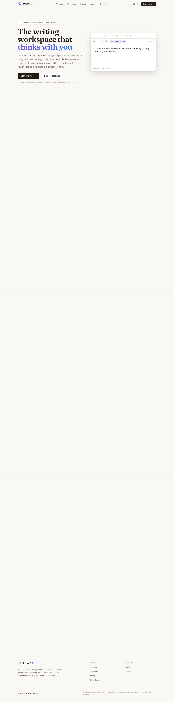
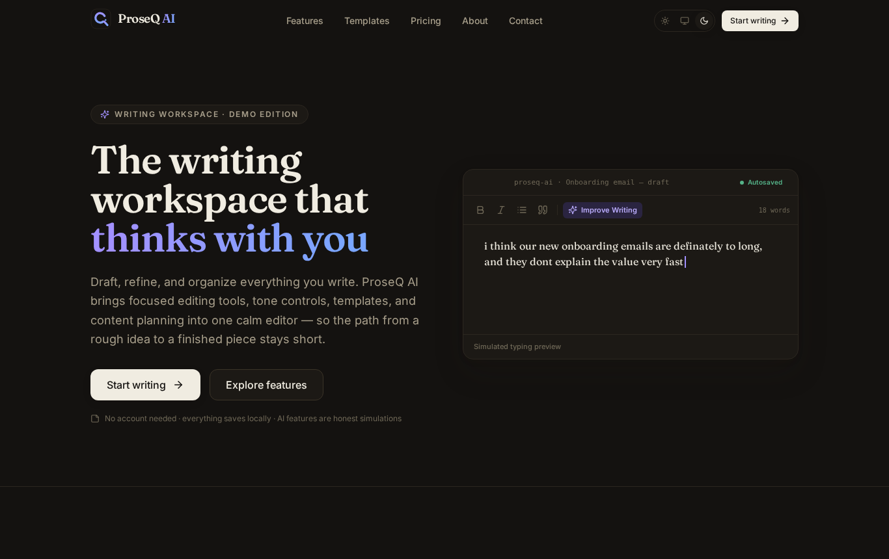
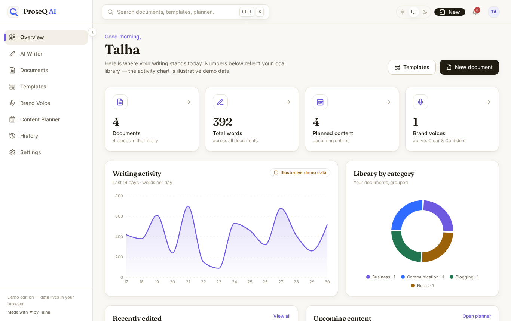
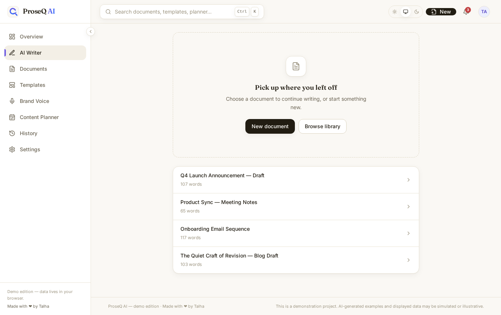
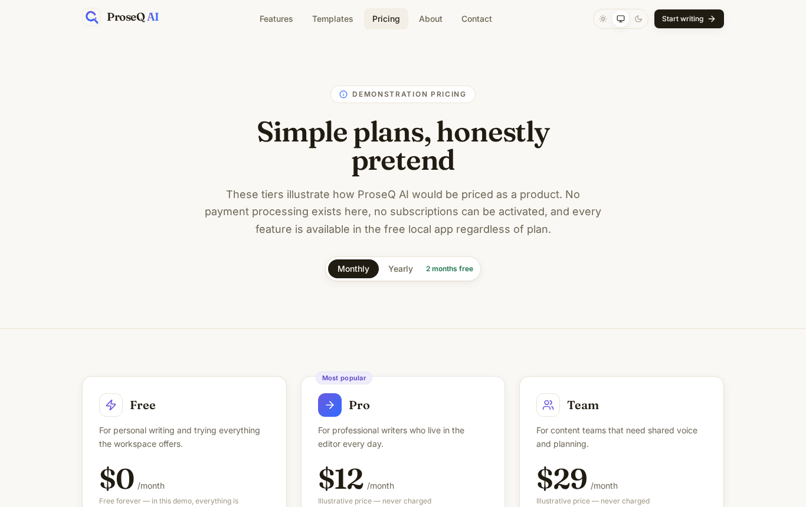
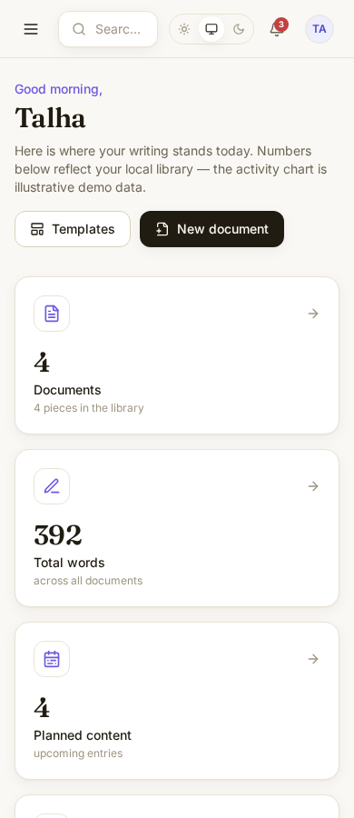

# ProseQ AI

**The writing workspace that thinks with you.**

A premium AI writing & content productivity SaaS — built as a **frontend demonstration** and deployed to GitHub Pages. ProseQ AI combines a focused writing editor, ten transparent (rule-based) writing tools, a document library, a 28-template library, brand voice profiles, a content planner, and version history — all running locally in your browser.

> **Made with ❤️ by Talha**
>
> This is a demonstration project. AI-generated examples and displayed data may be simulated or illustrative.



---

## Table of contents

1. [Project overview](#project-overview)
2. [Features](#features)
3. [Technology stack](#technology-stack)
4. [Installation](#installation)
5. [Development commands](#development-commands)
6. [Production build](#production-build)
7. [Deployment (GitHub Pages)](#deployment-github-pages)
8. [Demo-mode limitations (honesty statement)](#demo-mode-limitations-honesty-statement)
9. [Project structure](#project-structure)
10. [Screenshots](#screenshots)
11. [License](#license)

---

## Project overview

ProseQ AI explores what a calm, local-first writing workspace can feel like:

- **A real application, not a mock.** Documents, profile, brand voices, planner entries, and preferences persist in IndexedDB/localStorage and survive refreshes. First-run demo data seeds once and never overwrites your edits.
- **Honest AI.** The writing tools are a transparent, rule-based *demo engine* (grammar rules, extractive summarization, tone lexicons, template-driven generation). Every result is labeled **simulated**, previewed before applying, and cancellable. The `AIProvider` interface is the seam where a real backend can be integrated later.
- **Editorial-tech design.** Warm ivory surfaces, deep ink typography (Fraunces + Inter), muted violet and electric-blue accents, restrained motion that respects `prefers-reduced-motion`.

## Features

### Marketing website
- Home page with an animated, interactive editor preview
- Features, Templates (28 templates, 7 categories), Pricing (clearly-labeled demonstration tiers), About, Contact (validated demo form)
- Working template preview + “Use template” that opens the structure in the editor
- SEO per page (title + meta description), Open Graph metadata, custom SVG favicon, designed 404 page

### Application
| Area | What works |
| --- | --- |
| **Overview** | Greeting with your saved name, library stats, illustrative activity chart (Recharts), category donut, recent documents, upcoming content, quick actions |
| **AI Writer** | Tiptap rich-text editor (headings, bold/italic/underline, lists, quotes, undo/redo), live word/character/reading-time stats, autosave + indicator, debounced snapshots |
| **Writing tools** | Improve Writing · Fix Grammar · Change Tone (7 tones) · Summarize · Expand · Shorten · Continue Writing · Generate Ideas · Create Outline · Rewrite Paragraph — each with options, processing state, notes, and Apply/Cancel |
| **Documents** | Create, rename, edit, delete (with confirmation), duplicate, favorite, search, filter, sort, category organization, grid/list views |
| **Templates** | 28 templates; “Use template” creates a real document |
| **Brand Voice** | Create/edit/delete voice profiles (tone, audience, preferences, words to use/avoid), select the active voice in the writer; the demo engine respects it |
| **Content Planner** | Month calendar, statuses (draft/planned/published), categories, notes, per-day entry creation, status advancement |
| **Version History** | Snapshots on meaningful changes (word-count deltas or 10-minute gaps, capped at 20/doc), preview + restore with a safety snapshot |
| **Settings** | Editable profile (name/email) that persists, light/dark/system theme, editor preferences (font size, width, spellcheck, autosave), data export/import/clear/reset |
| **Search & notifications** | Ctrl/⌘+K global search across documents, templates, voices, planner; activity feed with unseen badge; toast notifications |
| **Export/Import** | Per-document `.txt` / `.md` / `.html` / clipboard; full-library JSON export; validated JSON import with conflict warnings |

## Technology stack

- **React 18 + TypeScript** (strict mode, no `any`)
- **Vite 5** — build tool, GitHub Pages base path
- **Tailwind CSS 3** — design system via CSS custom properties (light/dark)
- **Framer Motion 11** — page transitions, reveals, modals, toasts
- **React Router 6** — `HashRouter` (GitHub Pages safe)
- **Zustand 5** — state with a centralized persistence layer
- **Tiptap 2** — the writing surface (ProseMirror)
- **Recharts 2** — lazy-loaded dashboard charts
- **React Hook Form + Zod** — forms & schema validation (contact, profile, voice, planner, import)
- **Lucide React** — iconography
- **@fontsource** — self-hosted Inter Variable + Fraunces Variable
- **Vitest + Testing Library + fake-indexeddb** — unit & component tests
- **Playwright** — optional end-to-end smoke suite against the production build

## Installation

```bash
git clone https://github.com/talhadev-pk/proseq-ai.git
cd proseq-ai
npm install
```

Requirements: **Node.js ≥ 18**, npm ≥ 9.

## Development commands

```bash
npm run dev        # start the dev server (http://localhost:5173/proseq-ai/)
npm run typecheck  # tsc --noEmit
npm run lint       # ESLint (flat config)
npm test           # Vitest unit + component tests (70 tests)
npm run preview    # serve the production build locally
```

### End-to-end smoke tests (optional)

```bash
npm run build && npm run preview &      # build + serve on :4173
npx playwright install chromium         # first time only
node e2e/smoke.mjs                      # 17 real-browser workflow checks
node e2e/overflow-sweep.mjs             # 15 routes × 3 widths overflow check
```

## Production build

```bash
npm run build
```

Outputs a optimized bundle to `dist/` with vendor chunking (`react`, `motion`, `editor`, `charts` — charts load lazily). Initial gzip payload is ~200 kB including fonts.

## Deployment (GitHub Pages)

The project is configured for:

```
https://talhadev-pk.github.io/proseq-ai/
```

- `base: '/proseq-ai/'` in `vite.config.ts`
- `HashRouter` so every route works without server rewrites
- GitHub Actions workflow: `.github/workflows/deploy.yml`

To deploy:

1. Push `main` to the repository `talhadev-pk/proseq-ai`.
2. In GitHub → **Settings → Pages → Build and deployment → Source**, choose **GitHub Actions**.
3. The workflow runs typecheck → lint → tests → build and publishes `dist/`. A red X blocks deployment; nothing broken ships.

## Demo-mode limitations (honesty statement)

This project is a **frontend demonstration**. To be explicit about what is and is not real:

- **The “AI” is simulated.** All writing tools run `src/services/ai` — a local, rule-based engine (spelling tables, lexicons, extractive summarization, template generation). No model, no API, no keys. Results always carry a “simulated” label and require your approval before anything changes.
- **There is no backend.** No accounts, no emails sent (the contact form validates and stores locally only), no telemetry, no uploads. All data lives in **your** browser storage.
- **Pricing is illustrative.** No payment processing exists; plan CTAs just open the app.
- **Dashboard activity data is illustrative.** Document counts and library contents are your real local data; the words-per-day chart is clearly labeled demo data.
- **The planner is local planning only.** Nothing is published to any external platform.
- **No real users, customers, or production integrations exist**, and none are claimed.

## Project structure

```
proseq-ai/
├── .github/workflows/deploy.yml   # CI: typecheck + lint + test + build + Pages deploy
├── e2e/                           # Playwright smoke & overflow suites (optional, local)
├── public/                        # favicon.svg, og-image.png, apple-touch-icon.png
├── screenshots/                   # captured for this README
└── src/
    ├── components/
    │   ├── app/                   # Sidebar, Topbar, SearchModal
    │   ├── brand/                 # Logo, ThemeToggle
    │   ├── marketing/             # Navbar, Footer, Hero editor preview, section heading
    │   └── ui/                    # Button, Modal, Toasts, Dropdown, Tabs, Switch, …
    ├── data/                      # 28 templates + first-run demo seeds
    ├── features/
    │   ├── overview/              # Recharts activity chart & category donut
    │   └── writer/                # Tiptap editor, toolbar, AI tools panel
    ├── hooks/                     # useMediaQuery, useDebouncedValue, useThemeEffect
    ├── layouts/                   # MarketingLayout, AppLayout
    ├── lib/                       # utils, markdown converter, SEO hook
    ├── pages/
    │   ├── app/                   # Overview, Writer, Documents, Templates,
    │   │                          # BrandVoice, Planner, History, Settings
    │   └── marketing/             # Home, Features, Templates, Pricing, About, Contact, 404
    ├── services/
    │   ├── ai/                    # AIProvider interface + rule-based demo engine
    │   ├── db.ts                  # IndexedDB (localStorage fallback) adapter
    │   ├── export.ts              # export/import + Zod validation
    │   └── storage.ts             # namespaced, versioned localStorage access
    ├── store/                     # Zustand stores + bootstrap (first-run logic)
    ├── styles/                    # Tailwind layer + design tokens + prose styles
    ├── test/                      # Vitest setup (jsdom polyfills)
    └── types/                     # shared domain types
```

## Screenshots

| Home (light) | Home (dark) |
| --- | --- |
|  |  |

| App overview | Writer |
| --- | --- |
|  |  |

| Pricing | Mobile (390px) |
| --- | --- |
|  |  |

## License

Released under the [MIT License](LICENSE) — © Talha.
